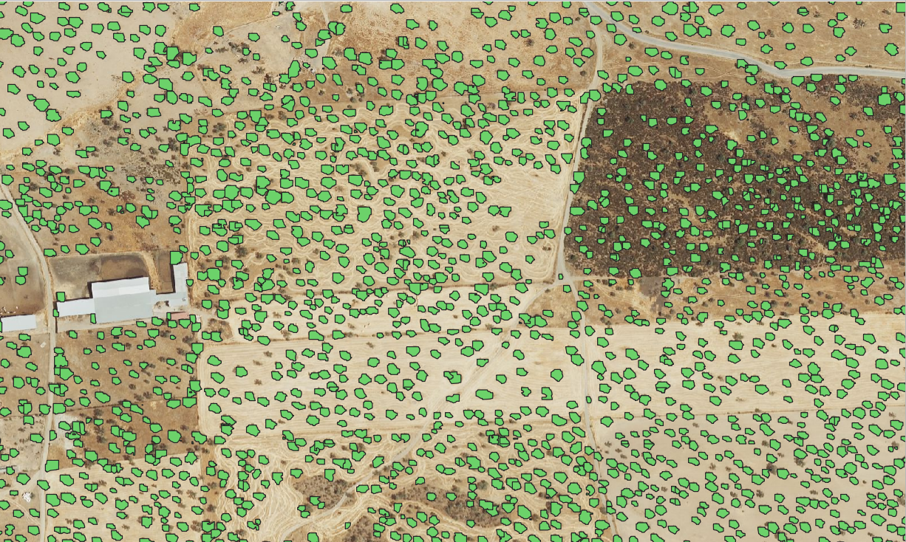
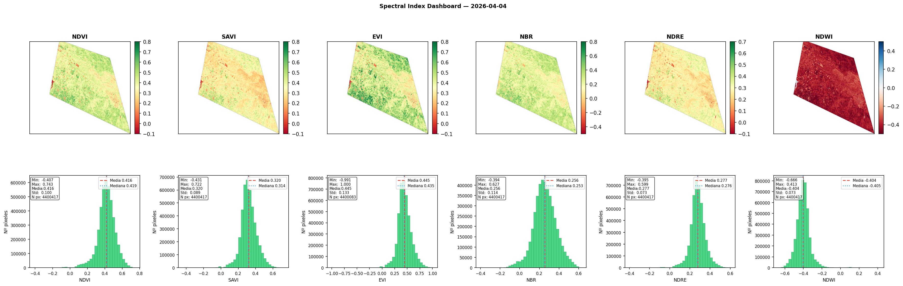
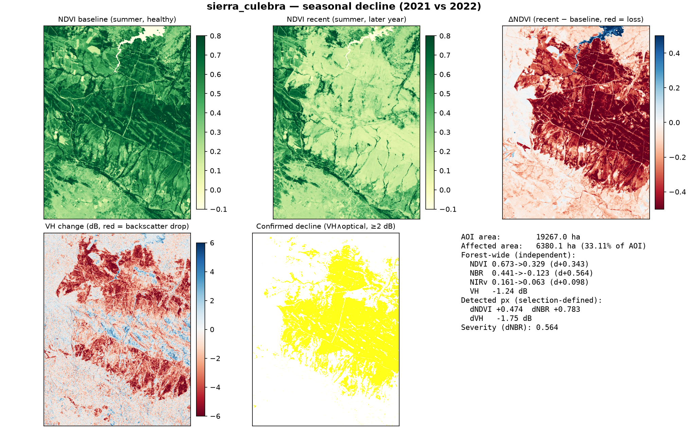
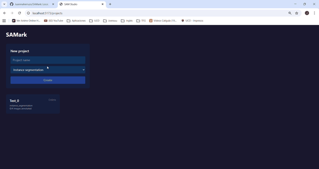

<h1 align="center">Juanma Herruzo</h1>

  <b>Forestry Engineering student building production-grade geospatial ML pipelines.</b> 
  UAV photogrammetry · Sentinel-1/2 remote sensing · deep learning for forest inventory 
  Córdoba, Spain

  
  
  
  
  
  
  

---

> **The bottleneck in forestry isn't data — it's tooling.** UAV imagery, Sentinel time series, LiDAR and NDVI are already free. What's missing are pipelines a *forester* can actually run, on real datasets, on hardware they own. That's the gap I work in.

## About me

I'm a forestry engineering student with a strong interest in geospatial analysis and machine learning. Forest management both generates and depends on very large volumes of data — UAV surveys, satellite time series, LiDAR, field inventories — and a good part of it stays underused for lack of accessible tooling. That is where I focus my work: building pipelines that bring technology into field data collection and make it faster, automate the processing and analysis of that data, and return results that are easy to interpret for specialists and non-specialists alike.

Most of it happens in the dehesas of southern Spain: flying the UAV
campaigns, walking the plots, and then sitting down with the imagery. I enjoy working at
that intersection between forestry and code, and I'm always glad to talk with people
working on similar problems.

## Flagship projects

### [Dehesa-Crown-Segmentation-YOLOv11](https://github.com/Juanmaherruzo/Dehesa-Crown-Segmentation-YOLOv11)
Instance segmentation of individual tree crowns on UAV orthomosaics.
Run over **14,506 ha at 25 cm/px, producing an inventory of 357,185 crowns** with per-tree area, diameter and centroid, exported to GeoPackage for QGIS.
Model accuracy is **mask mAP@50-95 = 42.3 %** on the validation split: good enough for stand-level structure, not for an exact individual count — the inventory is a lower bound, and the repository says so.
Out-of-core tiling with one model instance per worker thread and explicit accounting of failed tiles, so a partial run can never be mistaken for a complete one.

### [sentinel2-spectraldex](https://github.com/Juanmaherruzo/sentinel2-spectraldex)
Sentinel-2 L2A pipeline on the Microsoft Planetary Computer STAC catalogue — no credentials, no subscriptions, COG range reads instead of full-scene downloads.
AOI-driven scene search, cloud filtering, scene de-duplication across processing baselines, automatic merging of AOIs that span several MGRS tiles, and **six spectral indices** (NDVI, SAVI, EVI, NBR, NDRE, NDWI) with a per-scene validation dashboard.

### [Sentinel-Forest-Tracker](https://github.com/Juanmaherruzo/Sentinel-Forest-Tracker)
Sentinel-1 + Sentinel-2 forest-disturbance monitoring: STAC-native Dask cube, omnibus Wishart change detection, Theil-Sen/Mann-Kendall trends.
**Sierra de la Culebra 2022 fire → 4,829 ha of error-adjusted forest loss**, scored against Hansen Global Forest Change at precision 0.75 / recall 0.99 / F1 0.85.
The raw map says 6,380 ha; the Olofsson (2014) adjustment corrects it down, which is the point of adjusted reporting. No confidence interval is quoted, because a wall-to-wall reference cannot support one.

### [annotation-station](https://github.com/Juanmaherruzo/annotation_station)
Local, **privacy-first** image annotation platform (FastAPI + React + SAM 2.1). Three-level embedding cache — in-memory, on-disk feature tensors, then recompute — runs on 4 GB VRAM; exports to YOLO-seg, YOLO-det and COCO. No telemetry, no outbound requests, no image ever leaves the machine.
This is the tool that produced the training data for the crown segmentation model above.

### [AOVE-price-predictor](https://github.com/Juanmaherruzo/AOVE-price-predictor)
Weekly olive-oil origin price forecasting: bimodal LSTM over climate and macroeconomic series, FastAPI service, Docker.
**Reported as a negative result.** Against a persistence baseline (MAE 0.057 €/kg) the model scores 0.073 — it does not beat repeating last week's price, and the README leads with that. Building the baseline is also what surfaced a two-week feature-alignment bug that had been inflating the error.

---

  
  

